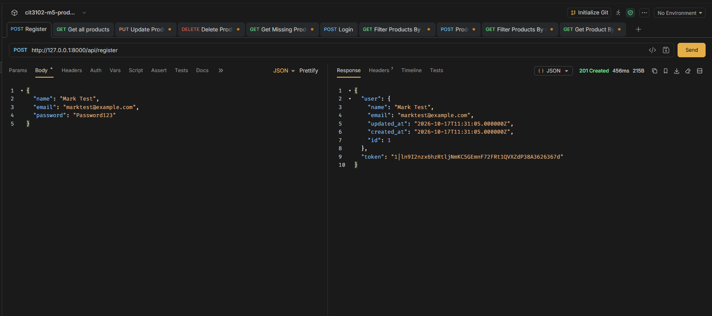
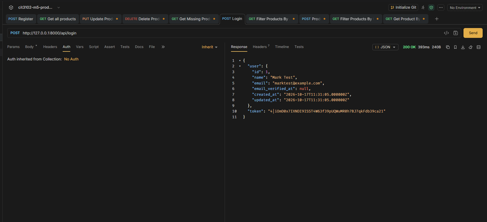
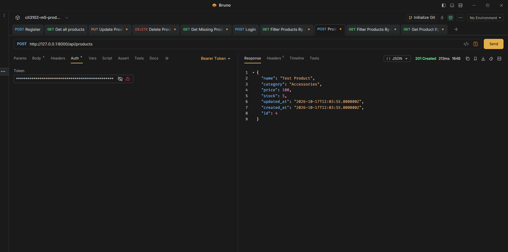
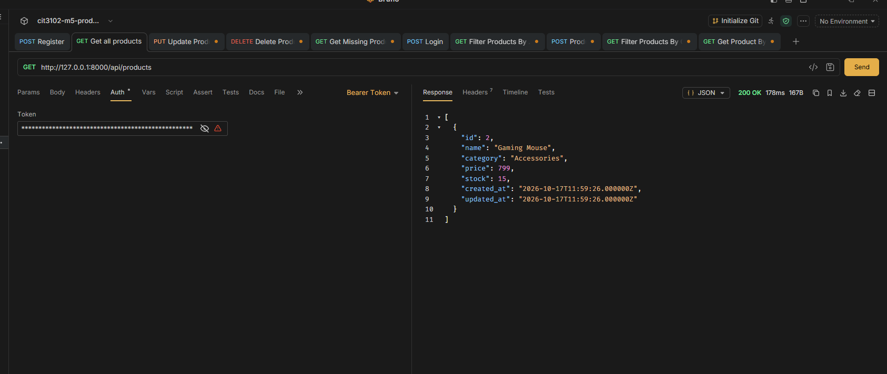
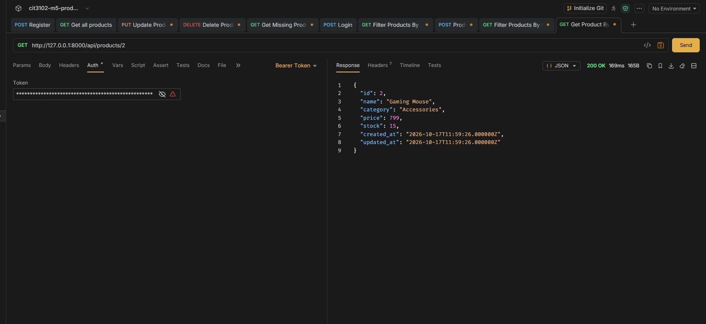
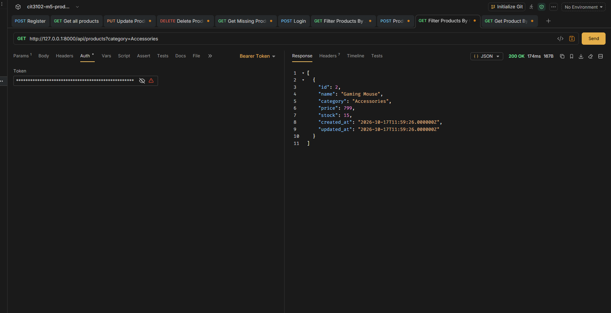
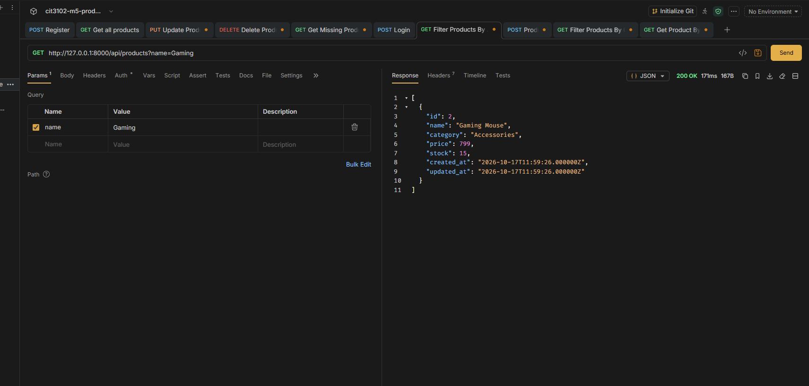
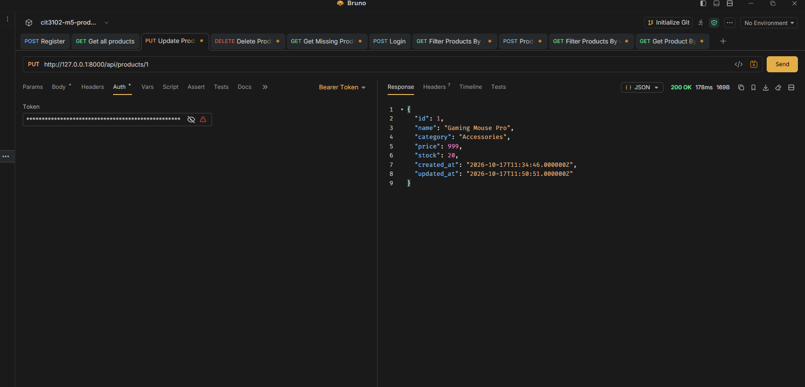
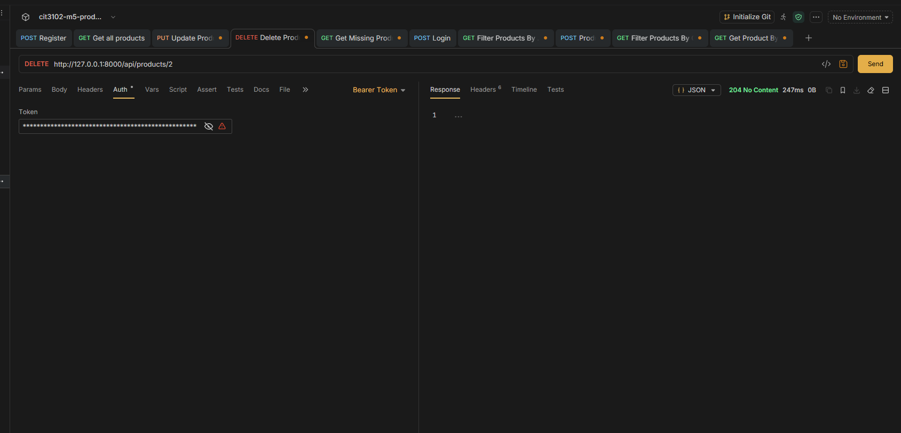
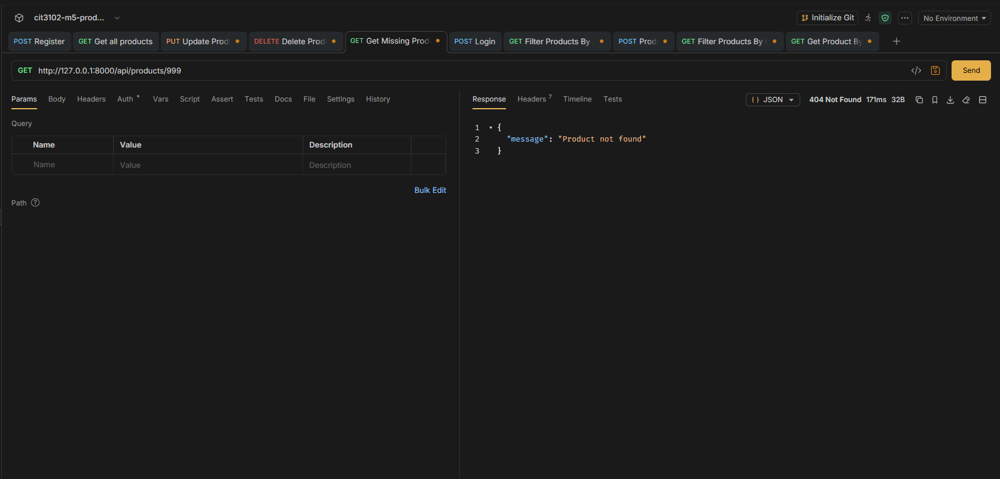

# CIT3102 M5 — Product API

## Project Information

- **Project Name:** cit3102-m5-product
- **Resource:** Product
- **Course:** CIT3102
- **Section:** IT3
- **Members:**
  - Mark Angelo H. Alarcon
  - Arwin Russel M. Guese

## Description

This project is a RESTful Product API built using Laravel. It supports product creation, retrieval, updating, and deletion, along with filtering products by name and category. Sanctum token authentication protects the product routes, while registration and login endpoints allow users to obtain API tokens.

## Technologies Used

- Laravel 12
- PHP
- SQLite
- Laravel Sanctum
- Bruno API Client

## Setup Instructions

1. Clone or download this repository.
2. Open a terminal in the project folder.
3. Install dependencies:

   ```bash
   composer install
   ```

4. Create your environment file:

   ```bash
   cp .env.example .env
   ```

   On Windows, you may copy `.env.example` and rename the copy to `.env`.

5. Generate the application key:

   ```bash
   php artisan key:generate
   ```

6. Ensure the SQLite database file exists at `database/database.sqlite`. Create an empty file there if necessary, and check that the database connection in `.env` is configured for SQLite.
7. Run database migrations:

   ```bash
   php artisan migrate
   ```

8. Start the Laravel development server:

   ```bash
   php artisan serve
   ```

9. The API base URL is `http://127.0.0.1:8000/api`.

## API Endpoints

| Method | Endpoint | Description | Authentication |
|---|---|---|---|
| POST | `/api/register` | Register a new user | Public |
| POST | `/api/login` | Log in and receive a token | Public |
| GET | `/api/products` | Retrieve all products; supports filters | Required |
| GET | `/api/products/{id}` | Retrieve a product by ID | Required |
| POST | `/api/products` | Create a product | Required |
| PUT | `/api/products/{id}` | Update a product | Required |
| DELETE | `/api/products/{id}` | Delete a product | Required |

### Product Filtering

The product listing endpoint supports these query parameters:

- `category` — filter by exact category.
- `name` — filter by a partial product name.

Examples:

```text
GET /api/products?category=Accessories
GET /api/products?name=Gaming
```

## Authentication

Register or log in to receive a Sanctum API token. For protected product requests, send the token in the `Authorization` header:

```text
Authorization: Bearer YOUR_TOKEN
Accept: application/json
```

Replace `YOUR_TOKEN` with your own token. Do not publish real tokens or credentials.

## Bruno API Testing

Screenshots of successful API requests and responses will be included below.

1. Register
2. Login
3. Create product
4. Get all products
5. Get product by ID
6. Filter by category
7. Filter by name
8. Update product
9. Delete product
10. Get a nonexistent product

### Screenshots

## API Test Screenshots

### 1. Register


### 2. Login


### 3. Create Product


### 4. Get All Products


### 5. Get Product by ID


### 6. Filter by Category


### 7. Filter by Name


### 8. Update Product


### 9. Delete Product


### 10. Get Missing Product

## Explanation of HTTP 204 No Content

The DELETE endpoint returns HTTP status code `204 No Content` when a product is successfully deleted. This status indicates that the server completed the request successfully and does not need to return a response body. The client can interpret the empty response as confirmation that the deletion succeeded. If the requested product does not exist, the API instead returns `404 Not Found`.

## Notes

- Product routes require valid Sanctum authentication.
- Do not commit the `.env` file or the `vendor/` directory.
- Verify the setup instructions and all API tests before submission.
